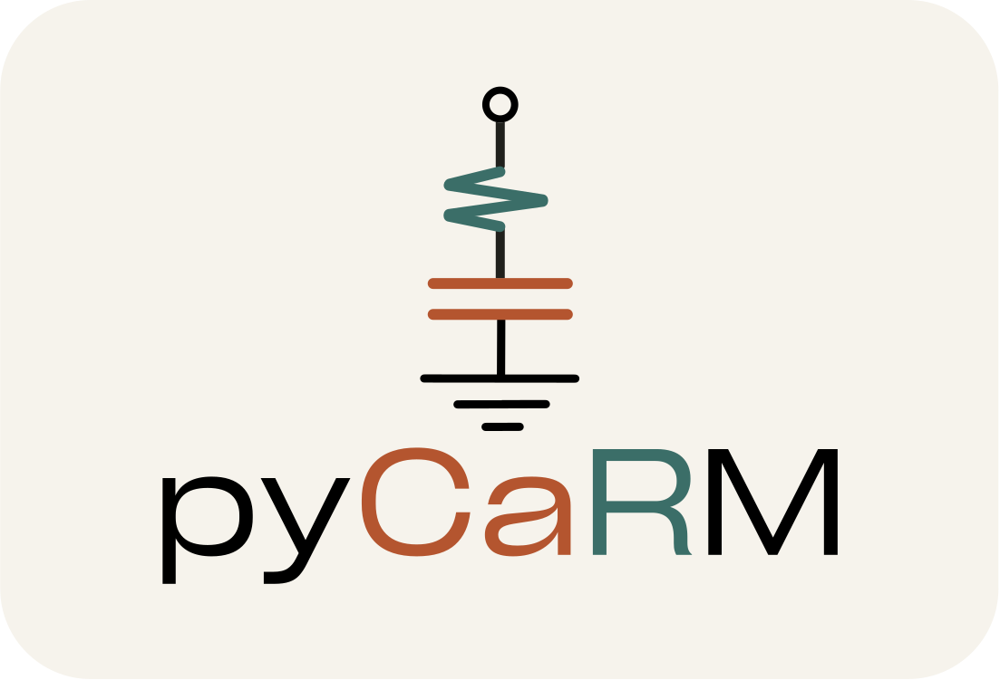

# pyCaRM

[](https://pypi.org/project/pyCaRM-BHE/)
[](https://pypi.org/project/pyCaRM-BHE/)
[](https://github.com/BETALAB-team/pyCaRM/actions/workflows/ci.yml)
[](https://github.com/astral-sh/ruff)
[](LICENSE)



**pyCaRM** (CApacity Resistance Model) is a Python library for the simulation of 
borehole heat exchanger (BHE) systems. It models the transient thermal response 
of the ground and borehole, supporting single and multi-borehole configurations 
with surface boundary conditions.

> 📖 **Documentation:** https://betalab-team.github.io/pyCaRM/

## Features

- Single and multi-borehole field configurations
- Supported BHE types: single U-tube, double U-tube, coaxial, helical
- Ground stratification support
- Surface boundary conditions (solar radiation, sky radiation, convection)
- Voronoi-based field decomposition for multi-borehole layouts
- Finite Line Source (FLS) thermal interference model
- Parallel and series borehole connection modes
- Heat flux mode: drive the simulation from a heat pump-side thermal load and
  supply temperature, with heat pump COP/EER performance accounted for
- Time-variable grout thermophysical properties driven by soil moisture
  content (irrigation input)

## Installation

Install from PyPI:
```bash
pip install pyCaRM-BHE
```

Alternatively, clone the repository and install from source:
```bash
git clone https://github.com/BETALAB-team/pyCaRM.git
cd pyCaRM
pip install .
```

**Developers:**
```bash
git clone https://github.com/BETALAB-team/pyCaRM.git
cd pyCaRM
pip install -e ".[dev]"
```

## Optional Dependencies

- [CoolProp](http://www.coolprop.org) — for computing fluid thermophysical properties. Install with `pip install pyCaRM-BHE[coolprop]`. See [Fluid Properties](https://betalab-team.github.io/pyCaRM/fluid_properties.html) for usage.

## Documentation

Full documentation is available at **https://betalab-team.github.io/pyCaRM/**.

## Examples

Complete working scripts for all supported configurations are available in the
`examples/` folder. See also the [documentation](https://betalab-team.github.io/pyCaRM/)
for detailed usage guides.

- `SingleUtube_multi_parallel.py` — multi-borehole field, parallel mode
- `SingleUtube_multi_series.py` — multi-borehole field, series mode
- `SingleUtube_multi_series_heat_flux.py` — multi-borehole field, series mode, heat flux (COP/EER) mode
- `SingleUtube.py` — single borehole, single U-tube
- `DoubleUtube.py` — single borehole, double U-tube
- `Coaxial.py` — single borehole, coaxial
- `Helical.py` — single borehole, helical
- `Helical_variable_properties.py` — single borehole, helical, time-variable grout properties from soil moisture

## Authors

Developed at **BETALAB** – Department of Industrial Engineering, University of Padova.

- Alessio Tollin
- Angelo Zarrella

## Citation

If you use CaRM in your research, please cite:
```
[Citation will be added after publication]
```

The models and methods CaRM builds on are listed in the
[References](https://betalab-team.github.io/pyCaRM/references.html) page of the documentation.

## License

MIT License — see [LICENSE](LICENSE) for details.