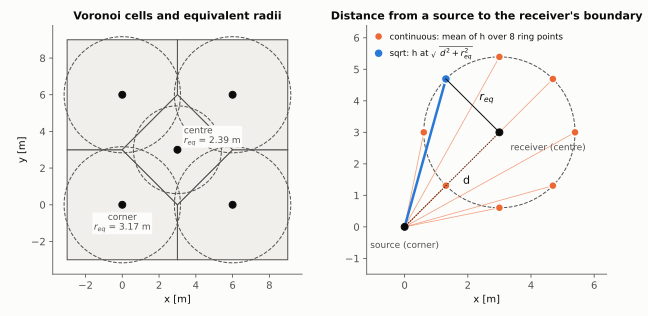
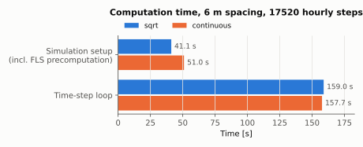
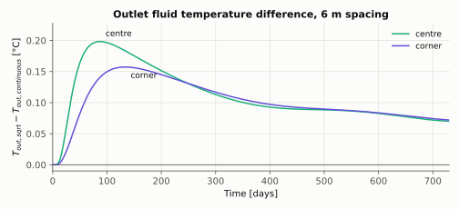
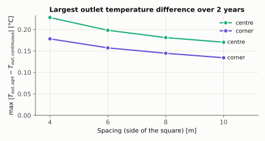
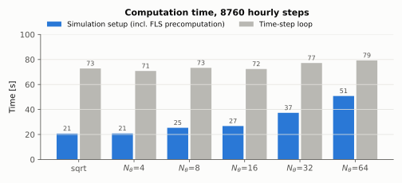
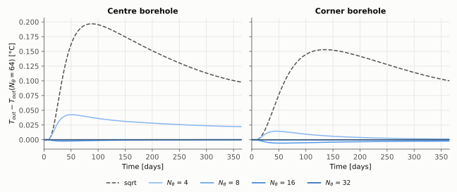

FLS Calculation Methods
=======================

pyCaRM precomputes a thermal response matrix using the Finite Line Source (FLS)
analytical model, with its real part and, by default, its image part (see
`Real and image parts`_). Two methods are available to evaluate the effective distance
between boreholes, controlled by the ``fls_mode`` parameter of
:class:`~carm.simulation.Simulation`.

Real and image parts
--------------------

The FLS response combines a real part and, by default, an image part, set by
the ``fls_image`` parameter of :class:`~carm.simulation.Simulation` (``True``
by default, ``False`` for the real part only). The
real part is the borehole as a line source of length :math:`H = L` in an
infinite medium. The image part is a sink mirrored above the ground surface:
it keeps the FLS temperature perturbation at zero on the surface. 
The top of the borehole is buried at depth
:math:`D = L_{sup}`, the thickness of the upper ground layer.

With :math:`\mathrm{ierf}(x) = x\,\mathrm{erf}(x) - (1 - e^{-x^2})/\sqrt{\pi}`,
the response at distance :math:`d` and time :math:`t` is

.. math::

   h(d, t) = \int_{1/\sqrt{4\alpha t}}^{\infty}
   \frac{e^{-d^2 s^2}}{2 H s^2}
   \Big[\underbrace{2\,\mathrm{ierf}(Hs)}_{\text{real}}
   + \underbrace{2\,\mathrm{ierf}((2D + H)s) - \mathrm{ierf}(2Ds)
   - \mathrm{ierf}((2D + 2H)s)}_{\text{image}}\Big]\, ds

following Claesson and Javed (2011). This equation is validated against
pygfunction (Cimmino, 2018) in the test suite.

Limitations
-----------

The FLS treats each borehole as a line source. Two cases are therefore an
approximation:

- **Very short times.** At the first time steps the heat has not yet
  travelled far from the borehole, and the line-source assumption does not
  describe this phase accurately.
- **Helical heat exchangers.** The heat source is a helix, not a line, so
  the FLS interference between helical boreholes is an approximation.

Overview
--------

Each borehole is assigned a Voronoi cell of area :math:`A_i`, from which an
equivalent radius is derived:

.. math::

   r_{eq,i} = \sqrt{\frac{A_i}{\pi}}

This radius represents the effective influence area of borehole :math:`i` and
is used to compute the distance entering the FLS integral. Two strategies are
implemented.

sqrt method (default)
---------------------

The effective distance between source borehole :math:`j` and receiver borehole
:math:`i` is computed as:

.. math::

   d_{ij} = \sqrt{d_{Euclidean,ij}^2 + r_{eq,i}^2}

where :math:`r_{eq,i}` is the equivalent radius of the **receiver** cell. This
is a scalar approximation — a single distance value per borehole pair — and is
the default method due to its low computational cost.

continuous method
-----------------

The receiver borehole wall is discretized into :math:`N_\theta` equally spaced
points along its equivalent radius:

.. math::

   \mathbf{p}_k = (x_i + r_{eq,i}\cos\theta_k,\ y_i + r_{eq,i}\sin\theta_k),
   \quad \theta_k = \frac{2\pi k}{N_\theta},\ k = 0, \ldots, N_\theta - 1

The FLS response is evaluated at each point and averaged:

.. math::

   \bar{h}_{ij} = \frac{1}{N_\theta} \sum_{k=0}^{N_\theta - 1} h(d_{ijk})

where :math:`d_{ijk}` is the distance from source :math:`j` to point
:math:`k` on receiver :math:`i`. This method is more accurate but
significantly more expensive.

Comparing the two methods
-------------------------

Both methods look at the same thing: the boundary of the receiver's cell, a
circle of radius :math:`r_{eq,i}`. The mean squared distance from source
:math:`j` to the points of that circle is :math:`d^2 + r_{eq,i}^2`, which is
exactly the squared distance to the point at 90° from the source direction.
So ``"sqrt"`` evaluates the FLS once, at that point, while ``"continuous"``
averages it over :math:`N_\theta` points of the circle. The two differ only
because :math:`h` is not linear in the distance.

   Left: a five-borehole field (four corners and a centre, 6 m square, field
   box extending 3 m beyond the outer boreholes) with its Voronoi cells and
   equivalent radii. Right: the distances each method uses from a corner
   source to the centre receiver.

The figures below compare the two methods on that field: single U-tube,
100 m boreholes, parallel connection, constant inlet temperature of 2 °C and
mass flow of 0.1657 kg/s, ground conductivity 1.8 W/(m K), synthetic
weather, two years of hourly steps. ``"continuous"`` is taken as the
reference.

   Computation time, measured on a single run on one machine. The extra cost
   of ``"continuous"`` is all in the FLS precomputation, done once when the
   simulation is built; the time-step loop is the same for both methods.

   Outlet fluid temperature difference between the two methods for the
   centre and a corner borehole. ``"sqrt"`` underestimates the interference,
   so its outlet temperature is higher. The difference peaks within the
   first months and then decreases.

   Largest outlet temperature difference over the two years, for square
   sides from 4 to 10 m. The field box always extends half a side beyond the
   outer boreholes.

Number of ring points in the continuous method
----------------------------------------------

``"continuous"`` uses :math:`N_\theta = 8` points on the receiver ring
(``FiniteLineSolution.N_THETA``). The figures below repeat the simulation of
the previous section (6 m square, one year of hourly steps) with
:math:`N_\theta` from 4 to 64, taking :math:`N_\theta = 64` as the
reference.

   Computation time, measured on a single run on one machine. Only the setup,
   which includes the FLS precomputation, grows with :math:`N_\theta`; the
   time-step loop is the same for every case.

   Outlet fluid temperature difference from :math:`N_\theta = 64` for the
   centre and a corner borehole. With :math:`N_\theta = 8` the largest
   difference is 0.006 °C, with :math:`N_\theta = 16` it is below
   0.001 °C. ``"sqrt"`` is shown for comparison.

Choosing a method
-----------------

.. list-table::
   :header-rows: 1
   :widths: 30 70

   * - ``fls_mode``
     - Cost
   * - ``"sqrt"``
     - Low — single distance per pair
   * - ``"continuous"``
     - High — scales with :math:`N_\theta \times n_{BHE}^2 \times n_{steps}`

Use ``"sqrt"`` (default) for parametric studies and large fields. Use
``"continuous"`` when high accuracy is required and the field is small.

Load superposition
------------------

Both methods store only the response increments
:math:`\Delta R_k = R_{k+1} - R_k` (the FLS integral over each time step),
computed once when the simulation is built. At step :math:`n` the wall
temperature penalty of borehole :math:`j` is the superposition of the whole
heat history,

.. math::

   \Delta T_j(n) = \frac{1}{2\pi k L} \sum_{t=0}^{n-1} \sum_i q_i(t)\, \Delta R_{n-1-t,\, ij}

evaluated as one matrix-vector product per step.

Response cache
--------------

The increments can be stored on disk with the ``fls_cache_dir`` parameter of
:class:`~carm.simulation.Simulation`:

.. code-block:: python

    simulation = Simulation(..., fls_cache_dir="fls_cache")

The increments are saved in that folder as a ``.npy`` file, with a ``.json``
file listing the inputs they were computed from (``fls_mode``, ``fls_image``,
time step, ground properties, borehole length and depth, field layout). A
later simulation of the same field pointing at the same folder reads them
instead of computing them again; flows, temperatures and weather can differ.
A file from a longer run also serves a shorter one. The time step must be
constant. ``None`` (default) keeps the increments in memory and writes
nothing.
